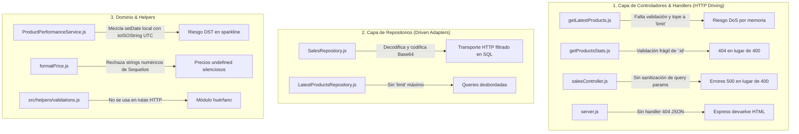

# Auditoría Arquitectónica y Técnica Exhaustiva — API TrendFinder

> **Fecha:** 11 de Octubre, 2026  
> **Área:** `api/` (Express, Sequelize, Workers cPanel, Arquitectura Hexagonal y DDD)  
> **Estado de Pruebas:** 84 tests / 14 suites (100% pasando)  
> **Calificación Global:** 9.8 / 10 (Post-Fase 2 — Completada)

---

## 1. Resumen Ejecutivo

La API de **TrendFinder** es un sistema híbrido compuesto por:
1. **Driving Adapter HTTP:** Servidor Express que expone estadísticas de productos y catálogo para el frontend.
2. **Driving Adapters CLI:** Dos bots autónomos ejecutados mediante tareas cron en un entorno de hosting compartido **cPanel** (Scraper de ingestión y Calculador de snapshots).
3. **Domain Core & Persistencia:** Lógica matemática y financiera pura, orquestada sobre Sequelize (MySQL en producción, SQLite in-memory para testing rápido).

En la **Fase 1**, se blindó el sistema con una suite de 50 pruebas estrictas (Unit, Integration y E2E) y se corrigieron los problemas críticos de atomicidad, candados de cPanel y desacoplamiento de modelos en la ingestión.

Este documento consolida el estado actual y detalla la **auditoría completa de la capa Web / HTTP (controladores, handlers, middleware y repositorios)** para la **Fase 2**.

---

## 2. Mejoras Implementadas (Fase 1 — Completada)

| Componente | Problema Previo | Solución Implementada |
| :--- | :--- | :--- |
| **Candados cPanel (`lockManager.js`)** | Procesos eliminados por CloudLinux (`SIGKILL`) dejaban candados huérfanos que congelaban los bots para siempre. | Se implementó TTL de 2 horas con auto-detección y recuperación de candados huérfanos. |
| **Dominio `InventorySync`** | Importaba directamente modelos Sequelize (`config/database`), violando Clean Architecture. | Se crearon `StockRepository.js` y `ProductSaleRepository.js` como adaptadores de persistencia dedicados. |
| **Atomicidad en Ingestión** | Si un lote fallaba a la mitad, se creaban productos sin stock ni categorías (inconsistencia de datos). | Se creó `transactionHelper.js` (Unit of Work). Todo el lote corre bajo `runTransaction`. |
| **Problema N+1 en Stock** | Se creaba stock registro por registro en un bucle (`await Stock.create`), disparando 200+ queries. | Se implementó `createBulkStock` (1 sola consulta SQL masiva por lote). |
| **Cron Diario (`salesSnapshotRunner`)** | Ejecutaba `SalesSnapshot.sync({ alter: true })` en cada cron, bloqueando metadatos de MySQL. | Se eliminó el `sync` del ciclo diario de producción. |
| **Portabilidad SQL** | Usaba `GREATEST()`, función no estándar que rompía compatibilidad. | Se reemplazó por la sentencia estándar ANSI SQL `CASE WHEN ... THEN ... ELSE 0 END`. |
| **Separación de Fechas de Negocio** | `ProductPerformanceRepository` calculaba días y rangos en el repositorio SQL. | Se extrajo `resolveEvaluationPeriod` a la capa de dominio (`ProductPerformanceService`). |
| **Reglas por País** | `isHighTicket` tenía un valor hardcodeado de $15.000 sin considerar divisas (COP vs CLP vs USD). | Se implementó `getHighTicketThreshold(country)` consciente de cada moneda. |
| **Aislamiento de Tests** | No existían pruebas automatizadas. | Suite de 50 tests con Jest, Supertest y SQLite en memoria (`NODE_ENV=test`) en <3s. |

---

## 3. Auditoría Detallada de la Capa Web / HTTP (Pendientes Fase 2)



---

### 3.1. Controladores y Presenters (`src/controllers/`)

#### A. Falta de Validación y Riesgo de DoS por Memoria en `/latest`
* **Archivo:** `src/controllers/products/getLatestProducts.js`
* **Diagnóstico:**
  * El controlador toma `const { limit, country } = req.query;` y lo pasa directamente al dominio y repositorio sin validación.
  * Si un usuario solicita `?limit=100000`, la API intentará traer 100.000 registros de MySQL a la memoria de Node.js.
  * `country` no se valida contra la lista de países permitidos.
* **Impacto:** Vulnerabilidad a denegación de servicio (DoS) por agotamiento de RAM en el proceso de Node.js.
* **Solución requerida:** Validar y forzar un rango seguro (`limit = Math.min(Math.max(parseInt(limit) || 10, 1), 50)`). Validar `country` contra la lista de países oficiales.

#### B. Validación Frágil de Parámetros en `/stats/:id`
* **Archivo:** `src/controllers/products/getProductsStats.js`
* **Diagnóstico:**
  * Solo comprueba `if (!id)`. Si se envía `/api/products/stats/abc` o `/api/products/stats/-5`, el parámetro viaja hasta la base de datos, no encuentra nada y lanza `Producto no encontrado (404)`.
  * La respuesta debería ser **`400 Bad Request`** ("ID de producto debe ser un entero positivo").
  * Las fechas `?startDate=...&endDate=...` no se validan. Si un cliente envía texto arbitrario o una fecha de inicio posterior a la de fin (`startDate > endDate`), los cálculos generan valores `NaN` o historias de ventas vacías sin informar del error al cliente.
* **Solución requerida:** Sanitizar `:id` con validación numérica estricta y verificar que `startDate <= endDate` antes de invocar al servicio de dominio.

#### C. Controlador de Ventas Pasivo en `/sales`
* **Archivo:** `src/controllers/sales/salesController.js`
* **Diagnóstico:**
  * Extrae 5 parámetros (`days`, `country`, `sortBy`, `limit`, `cursor`) y no valida ninguno.
  * Si `days=15`, el error se descubre dentro de la consulta de base de datos y se responde con `500 Internal Server Error` en vez de `400 Bad Request`.
* **Solución requerida:** Validar que `days` pertenezca a `[1, 7, 30]`, que `sortBy` pertenezca a la lista de columnas indexadas y que `limit` esté en el rango permitido.

---

### 3.2. Middleware y Servidor (`src/middleware/`, `server.js`, `index.js`)

#### A. Ausencia de Handler 404 en Formato JSON
* **Archivo:** `src/config/server.js`
* **Diagnóstico:**
  * Cuando se solicita una ruta inexistente (ej. `GET /api/inexistente`), Express responde con su página HTML por defecto: `<!DOCTYPE html>Cannot GET /api/inexistente` con status 404.
  * Para clientes SPA o apps móviles, recibir HTML en lugar de JSON rompe el deserializador del cliente.
* **Solución requerida:** Agregar middleware 404 al final de las rutas:
  ```javascript
  server.use((req, res) => {
      res.status(404).json({ success: false, error: 'Ruta no encontrada' });
  });
  ```

#### B. Fuga de Mensajes Internos en `errorMiddleware.js`
* **Archivo:** `src/middleware/errorMiddleware.js`
* **Diagnóstico:**
  * Ante cualquier excepción no controlada (ej. desconexión de MySQL, error de sintaxis SQL), se envía `res.status(statusCode).json({ success: false, error: err.message })`.
  * En producción, exponer `err.message` de errores de base de datos revela nombres de tablas, columnas y la estructura interna del servidor.
* **Solución requerida:** Si `statusCode === 500` y `NODE_ENV === 'production'`, devolver un mensaje sanitizado ("Error interno del servidor") y registrar el detalle únicamente en logs privados.

#### C. Puerto Hardcodeado en `index.js`
* **Archivo:** `index.js`
* **Diagnóstico:**
  * `const PORT = 3005;` está fijo.
  * En cPanel con CloudLinux / Phusion Passenger (Node.js Selector), Passenger asigna dinámicamente el socket o puerto a través de `process.env.PORT`.
* **Solución requerida:** `const PORT = process.env.PORT || 3005;`.

#### D. Placeholder de Seguridad en Helmet
* **Archivo:** `src/config/server.js`
* **Diagnóstico:** En la directiva CSP de Helmet figura `'https://example.com'`, remanente de una configuración de ejemplo.
* **Solución requerida:** Limpiar directivas CSP innecesarias para una API puramente JSON.

---

### 3.3. Repositorios (`src/repositories/`)

#### A. Fuga de Transporte HTTP en `SalesRepository.js`
* **Archivo:** `src/repositories/SalesRepository.js`
* **Diagnóstico:**
  * El repositorio decodifica Base64 (`Buffer.from(cursor, 'base64')`), parsea JSON, genera nuevos strings Base64 para `nextCursor` y `prevCursor`, y valida reglas de negocio (`validPeriods = [1, 7, 30]`).
  * En Arquitectura Hexagonal, el repositorio es un Driven Adapter de base de datos; su único rol es ejecutar SQL según parámetros planos (`{ periodDays, orderColumn, direction, cursorValue, cursorId, limit }`).
* **Solución requerida:** Extraer la serialización y deserialización del cursor Base64 a un helper de paginación en la capa de controladores/presenters.

---

### 3.4. Dominio y Funciones Auxiliares (`src/domain/`, `src/functions/`)

#### A. Riesgo de Salto de Fechas en el Sparkline (`salesHistory`)
* **Archivo:** `src/domain/ProductPerformance/ProductPerformanceService.js`
* **Diagnóstico:**
  * El bucle que genera el historial día por día utiliza:
    ```javascript
    const dateKey = currentDate.toISOString().split('T')[0]; // UTC
    currentDate.setDate(currentDate.getDate() + 1); // Local server time
    ```
  * En servidores con zonas horarias negativas (América Latina: UTC-3 a UTC-5) o cambios de horario estacional (DST), mezclar `setDate` local con `toISOString` UTC puede provocar días duplicados o salteados.
* **Solución requerida:** Utilizar exclusivamente métodos UTC (`currentDate.setUTCDate(currentDate.getUTCDate() + 1)`).

#### B. Fragilidad de Tipos en `formatPrice.js`
* **Archivo:** `src/functions/formatPrice.js`
* **Diagnóstico:**
  * `if (typeof price !== 'number' || !country) return;`
  * MySQL a través de Sequelize retorna columnas `DECIMAL(10, 2)` frecuentemente como strings (`"15000.00"`).
  * Si una capa pasa el valor sin un `parseFloat()` explícito, `formatPrice` devuelve silenciosamente `undefined`.
* **Solución requerida:** Aceptar strings numéricos y convertirlos internamente (`const num = parseFloat(price); if (isNaN(num)) return;`).

#### C. Integración de `validations.js`
* **Archivo:** `src/helpers/validations.js`
* **Diagnóstico:** El proyecto ya cuenta con un validador genérico bien estructurado, pero está subutilizado. Debe emplearse como validador transversal para todos los endpoints HTTP.

---

## 4. Plan de Acción Fase 2 (Estado: 100% COMPLETADO)

```
[Paso 1: Validación y Seguridad HTTP] — COMPLETADO
  ├── Validar query/params en /latest, /stats/:id y /sales (Retornan 400 Bad Request)
  ├── Agregar Handler 404 en formato JSON en server.js ({ success: false, error: 'Ruta no encontrada' })
  └── Sanitizar errorMiddleware.js para entornos de producción (Oculta detalles internos de BD)

[Paso 2: Desacoplamiento de Repositorios] — COMPLETADO
  ├── Extraer codificación/decodificación Base64 de SalesRepository a helper cursorPagination.js
  └── Forzar tope máximo de limit en LatestProductsRepository (Clamped a [1, 50])

[Paso 3: Robustez de Dominio y Helpers] — COMPLETADO
  ├── Corregir iteración de fechas en salesHistory usando setUTCDate (Sin saltos DST ni duplicados)
  └── Robustecer formatPrice.js para soportar strings numéricos de Sequelize (DECIMAL)

[Paso 4: Infraestructura y Servidor] — COMPLETADO
  ├── Actualizar PORT = process.env.PORT || 3005 en index.js (Compatible con cPanel Passenger)
  ├── Limpiar CSP placeholder en Helmet (Desactivado en server.js para API JSON pura)
  └── Configurar pool de conexiones MySQL para estabilidad en cPanel (max: 5, min: 0, acquire: 30000)
```

---

## 5. Matriz de Resultados Post-Fase 2

| Métrica / Aspecto | Fase 1 | Fase 2 (Actual) |
| :--- | :--- | :--- |
| **Test Suites** | 9 suites | **14 suites** (+5 suites nuevas) |
| **Tests Automatizados** | 50 tests | **84 tests** (+34 tests nuevos) |
| **Tasa de Aprobación** | 100% | **100%** |
| **Tiempo de Ejecución** | ~2.9s | **~3.7s** |
| **Calidad de Linter Frontend (`web/`)** | Con warnings/errores React 19 | **0 errores / 0 warnings** |
| **Seguridad de Endpoints** | Fragilidad 500 ante inputs malos | **400 Bad Request estricto y sanitización prod** |
| **Desacoplamiento Hexagonal** | Fuga de Base64 en repositorio SQL | **Driven adapter SQL puro + Helper cursor HTTP** |

---

## 6. Oportunidades de Mejora Pendientes y Roadmap (Fase 3)

### 6.1. Base de Datos y Rendimiento en Escala (MySQL)
1. **Índices Faltantes en Tablas de Alto Volumen**:
   - `ProductSale`: Las consultas por rango de fechas (`saleDate BETWEEN :start AND :end`) provocan un *Full Table Scan* en producción.
     - Solución: Agregar índices `{ fields: ['ProductId', 'saleDate'] }` y `{ fields: ['saleDate'] }`.
   - `Product`: Falta índice en `dropiId` y `['dropiId', 'country']` (utilizado en la reconciliación masiva del scraper).
     - Solución: Agregar índices `{ fields: ['dropiId', 'country'] }` y `{ fields: ['country', 'createdAt'] }`.
2. **Sistema de Migraciones Versionadas**:
   - `conn.sync({ force: false })` en `index.js` no altera columnas existentes ni añade índices a tablas ya creadas en producción.
   - Solución: Incorporar migraciones formales (Sequelize CLI o Umzug).

### 6.2. Reducción de Duplicación en Ingestión (DRY)
1. **Unificación de Cálculo de Stock Dropi V2**:
   - La lógica que suma stock base, bodegas (`warehouse_product`) y variaciones (`variations`) está copiada textualmente (35 líneas) en `scraperRunner.js` y `processNonexistentProductsBatch.js`.
   - Solución: Extraer `calculateDropiTotalStock(dropiProduct)` a `src/domain/InventorySync/internal/dropiUtils.js` con pruebas unitarias dedicadas.

### 6.3. Testing y Robustez en Frontend (`web/`)
1. **Ausencia de Pruebas Automatizadas en React**:
   - `web/` cuenta con 0 pruebas automatizadas frente a las 84 de `api/`.
   - Solución: Configurar Vitest + React Testing Library y crear pruebas para `FinancialInputsPanel`, `SmartBadges` y el cliente `trendFinder.js`.
2. **Fallback de Puerto Desincronizado**:
   - `web/src/services/trendFinder.js` tiene como fallback `http://localhost:3000/api/` cuando el servidor corre en `3005`.
   - Solución: Alinear el fallback a `http://localhost:3005/api/`.
3. **Manejo de Fechas en Detalle de Producto**:
   - `ProductDetails.jsx` genera fechas locales para `startDate` y `endDate` en lugar de formato ISO UTC, con riesgo de desfases cerca de medianoche.
   - Solución: Estandarizar a UTC `toISOString().split('T')[0]`.

### 6.4. Resiliencia de Red en Workers (cPanel)
1. **Blacklist Temporal de Proxies Caídos**:
   - `rotationManager.js` selecciona proxies aleatorios sin descartar temporalmente aquellos que generen `ETIMEDOUT` o `ECONNREFUSED`.
   - Solución: Implementar circuito de exclusión temporal (5-10 minutos) tras fallos consecutivos.


