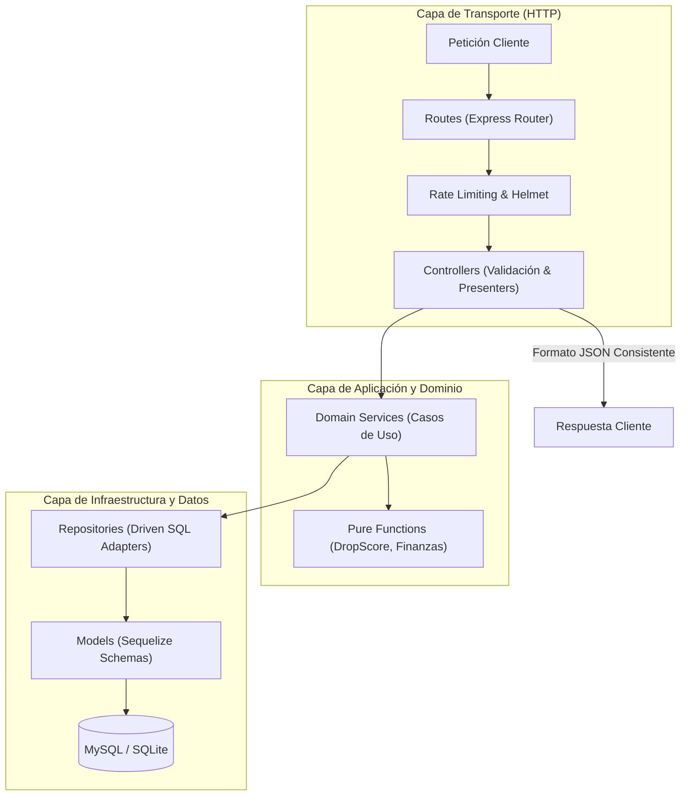
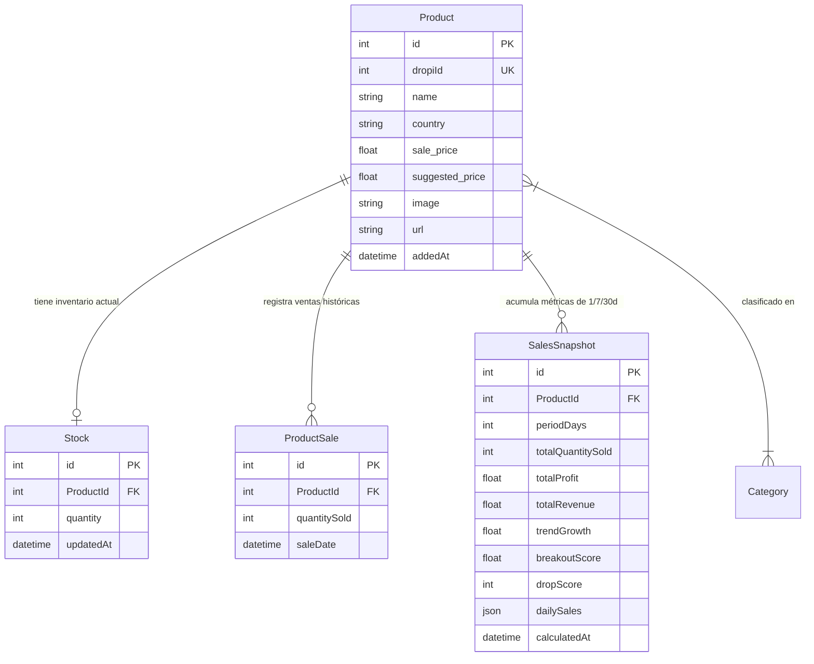

# Guía del Desarrollador — Backend REST API (TrendFinder API)

> [!NOTE]
> **Puerta de Entrada del Backend**: Este archivo proporciona una guía rápida para levantar la API, comprender la Clean Architecture y añadir nuevos endpoints. Para las especificaciones técnicas exhaustivas de los contratos JSON de cada endpoint, consulta [`docs/api/`](../docs/api/README.md).

Esta guía documenta la arquitectura técnica, configuración local, modelo de persistencia, catálogo de endpoints REST y el procedimiento paso a paso para extender la API con nuevos endpoints siguiendo los principios de **Clean Architecture**.

---

## 📌 1. Visión General y Stack Tecnológico

El backend de **TrendFinder** es un servicio HTTP REST diseñado bajo principios de arquitectura limpia, alta concurrencia y tolerancia a fallos:

- **Entorno de Ejecución**: [Node.js](https://nodejs.org/) (versiones LTS `>= 18.x`, probado y optimizado en Node 20.x).
- **Framework Web**: [Express 5](https://expressjs.com/) con middlewares de seguridad ([Helmet](https://helmetjs.github.io/), CORS, Express Rate Limit).
- **ORM y Persistencia**: [Sequelize 6](https://sequelize.org/) con arquitectura de base de datos dual:
  - **MySQL 8+** para entornos de desarrollo y producción.
  - **SQLite en memoria** (`:memory:`) para la ejecución hermética e instantánea de la suite de pruebas automatizadas.
- **Testing**: [Jest](https://jestjs.io/) y [Supertest](https://github.com/ladjs/supertest) ejecutados en serie (`--runInBand`).

---

## 🚀 2. Inicio Rápido en Desarrollo Local

### 2.1 Requisitos Previos
- Node.js `>= 18.0.0` y npm `>= 9.0.0`.
- Servidor MySQL local activo (o acceso a una base de datos de desarrollo).

### 2.2 Instalación
```bash
# Navegar al directorio del backend
cd api

# Instalar dependencias
npm install
```

### 2.3 Variables de Entorno (`.env`)
Crea un archivo `.env` en la raíz de `api/` tomando como referencia esta plantilla:

```ini
# Configuración del Servidor HTTP
PORT=3005
NODE_ENV=development

# Conexión a Base de Datos MySQL
DB_HOST=127.0.0.1
DB_PORT=3306
DB_NAME=trendfinder_db
DB_USER=root
DB_PASSWORD=tu_password_local

# Parámetros y Tokens de Integración con Dropi
DROPI_CATEGORIES=belleza,tecnologia,hogar
DROPI_IMG_URLS3=https://s3.dropi.co/images/

# Credenciales Regionales de Dropi (Configurables en src/config/config.js)
DROPI_CL_TOKEN=tu_token_dropi_chile
DROPI_CL_API_PRODUCTS=https://api.dropi.cl/api/products
DROPI_CL_IMG_URL=https://s3.dropi.cl/images/
DROPI_CL_DETAILS_PRODUCTS=https://api.dropi.cl/api/products/details
```

> [!NOTE]
> **Configuración Multi-País y Workers de Scraping**:
> Para agregar más países soportados (Colombia, México, Panamá, etc.), define sus endpoints y tokens en `api/src/config/config.js` dentro del array `dropi_country`. Además, si vas a ejecutar los bots de scraping, consulta [`api/src/workers/README.md`](src/workers/README.md) para configurar `proxies.txt` y `tokens.txt` en `api/src/adapters/dropiApi/config/`.

### 2.4 Ejecución del Servidor
```bash
# Modo desarrollo con recarga automática (Nodemon)
npm run dev

# Modo producción
npm start

# Ejecutar la suite completa de pruebas (100% en memoria con SQLite)
npm test
```
Al arrancar, Sequelize sincronizará los modelos relacionales automáticamente (`conn.sync({ force: false })`) y el servidor responderá en `http://localhost:3005/api/`.

---

## 🏛️ 3. Clean Architecture y Separación de Capas

El backend adopta una estructura modular en capas concéntricas donde el flujo de dependencias siempre apunta hacia adentro (hacia el dominio puro):



### Reglas de Oro Arquitectónicas

1. **Funciones Matemáticas Puras (`src/functions/`)**:
   - `salesCalculations.js`, `financialCalculations.js`, `formatPrice.js`.
   - **Prohibido**: Importar Sequelize, modelos, módulos de red o acceder a `req`/`res`.
   - Son 100% deterministas: para una misma entrada, retornan exactamente la misma salida sin efectos secundarios.
2. **Capa de Dominio (`src/domain/`)**:
   - Orquesta la lógica del negocio (ej. `ProductPerformance`, `SalesPerformance`, `InventorySync`).
   - No debe manipular objetos HTTP de Express (`req`, `res`). Si ocurre un error de negocio, lanza excepciones con código de estado opcional (ej. `error.statusCode = 404`).
3. **Capa de Repositorios (`src/repositories/`)**:
   - Encapsula exclusivamente las consultas SQL a través de Sequelize.
   - No contiene lógica de presentación ni codificación de cursores en Base64 (la serialización de cursores pertenece a la capa HTTP).
4. **Capa de Controladores y Rutas (`src/controllers/`, `src/routes/`)**:
   - Valida estrictamente los parámetros de entrada (`req.query`, `req.params`, `req.body`) retornando `400 Bad Request` si la entrada es inválida.
   - Aplica *Presenters* para transformar los datos crudos del dominio al contrato JSON oficial de la API.
   - Todo endpoint público debe protegerse con `limiterMiddleware`.

---

## 📡 4. Catálogo Oficial de Endpoints REST

Todas las rutas están prefijadas por `/api`.

### 4.1 Búsqueda de Productos en Catálogo
- **Método y Ruta**: `GET /api/products/search`
- **Controlador**: `searchProducts.js`
- **Descripción**: Realiza búsquedas de texto en el catálogo con soporte de filtrado por país, ordenamiento y paginación tradicional.
- **Parámetros de Consulta (Query Params)**:
  | Parámetro | Tipo | Requerido | Valores Permitidos / Descripción |
  | :--- | :--- | :--- | :--- |
  | `q` | `string` | **Sí** | Término de búsqueda (mínimo 2 caracteres útiles). |
  | `country` | `string` | No | Lista blanca: `Colombia`, `Chile`, `México`, `Panamá`, `Ecuador`, `Perú`, `España`. |
  | `limit` | `integer` | No | Límite de resultados (entre 1 y 50, defecto: 10). |
  | `page` | `integer` | No | Número de página (defecto: 1). |
  | `sortBy` | `string` | No | `recent`, `oldest`, `price_asc`, `price_desc`, `name_asc`, `name_desc`. |
- **Ejemplo de Respuesta (200 OK)**:
  ```json
  {
    "success": true,
    "query": "humidificador",
    "pagination": {
      "page": 1,
      "limit": 10,
      "totalMatches": 45,
      "totalPages": 5,
      "hasNextPage": true,
      "hasPrevPage": false
    },
    "data": [
      {
        "productId": 1042,
        "dropiId": 89541,
        "name": "Humidificador Ultrasónico LED",
        "country": "Chile",
        "image": "https://s3.dropi.cl/images/humidificador.jpg",
        "price": "$ 8.990",
        "rawPrice": 8990,
        "suggestedPriceCod": "$ 24.990",
        "unitProfitCod": "$ 9.200",
        "suggestedPricePrepaid": "$ 21.990",
        "unitProfitPrepaid": "$ 10.450",
        "stock": 140,
        "url": "https://app.dropi.cl/product/89541"
      }
    ]
  }
  ```

---

### 4.2 Últimos Productos Añadidos
- **Método y Ruta**: `GET /api/products/latest`
- **Controlador**: `getLatestProducts.js`
- **Descripción**: Retorna los productos más recientemente ingestados en el sistema con su simulación de márgenes iniciales.
- **Parámetros de Consulta**:
  - `limit` (*opcional*, 1-50, defecto: 10).
  - `country` (*opcional*, validado con lista blanca).
- **Ejemplo de Respuesta (200 OK)**:
  ```json
  {
    "success": true,
    "totalReturned": 10,
    "data": [ ... ]
  }
  ```

---

### 4.3 Métricas y Estadísticas de un Producto Específico
- **Método y Ruta**: `GET /api/products/stats/:id`
- **Controlador**: `getProductsStats.js`
- **Descripción**: Proporciona el perfil analítico completo de un producto: DropScore, historial de ventas diarias, métricas de breakout y desglose financiero interactivo.
- **Parámetros de Ruta**:
  - `:id` (*requerido*): ID numérico positivo del producto en base de datos.
- **Parámetros de Consulta (Opcionales)**:
  - `startDate`: Fecha inicial en formato ISO (`YYYY-MM-DD`).
  - `endDate`: Fecha final en formato ISO (`YYYY-MM-DD`, `startDate <= endDate`).
  - `days`: Atajo numérico de días hacia atrás (ej. `7` o `30`).
  - `country`: País de consulta para formateo de moneda.
  - Parámetros financieros personalizados (para simulación dinámica): `deliveryRatePct`, `shippingCost`, `returnShippingCost`, `platformFeeRate`, `cpa`, `desiredProfit`.
- **Ejemplo de Respuesta (200 OK)**:
  ```json
  {
    "success": true,
    "data": {
      "productId": 1042,
      "dropiId": 89541,
      "name": "Humidificador Ultrasónico LED",
      "country": "Chile",
      "stock": 140,
      "price": "$ 8.990",
      "dropScore": 88,
      "isDeclining": false,
      "isHighTicket": false,
      "hasLowStock": false,
      "suggestedPriceCod": "$ 24.990",
      "unitProfitCod": "$ 9.200",
      "salesInfo": {
        "totalQuantitySold": 128,
        "totalRevenue": "$ 1.150.720",
        "totalProfit": "$ 1.177.600",
        "salesAverage": 4.27,
        "maxDailySales": 12,
        "trendGrowthPercentage": 45.5,
        "isBreakout": false,
        "breakoutScore": 0
      },
      "salesHistory": [
        { "date": "2026-10-10", "quantity": 8 },
        { "date": "2026-10-11", "quantity": 12 }
      ]
    }
  }
  ```

---

### 4.4 Tendencias de Ventas con Paginación por Cursor
- **Método y Ruta**: `GET /api/sales`
- **Controlador**: `salesController.js`
- **Descripción**: Endpoint principal de inteligencia de mercado. Consulta los snapshots de ventas pre-computados (1, 7 o 30 días) ordenados por rentabilidad, volumen o DropScore.
- **Parámetros de Consulta**:
  | Parámetro | Tipo | Requerido | Descripción |
  | :--- | :--- | :--- | :--- |
  | `days` | `integer` | No | Ventana analítica (`1`, `7` o `30`, defecto: `7`). |
  | `country` | `string` | No | Filtro regional normalizado. |
  | `sortBy` | `string` | No | Criterio de orden: `profit`, `sales`, `revenue`, `performance`, `trend`, `breakout`. |
  | `cursor` | `string` | No | Cursor opaco Base64 (`{ value, id, dir }`) para paginación bidireccional. |
  | `limit` | `integer` | No | Límite por página (1-50, defecto: 10). |

> [!NOTE]
> `/api/sales` utiliza los parámetros financieros estándar pre-computados en los snapshots diarios para ordenar grandes catálogos eficientemente. Si el cliente requiere simular costos personalizados en tiempo real (ej. variar CPA o costo de devolución), dicha simulación detallada se calcula en el endpoint unitario [`GET /api/products/stats/:id`](#43-métricas-y-estadísticas-de-un-producto-específico).
- **Ejemplo de Respuesta (200 OK)**:
  ```json
  {
    "success": true,
    "periodDays": 7,
    "pagination": {
      "prevCursor": null,
      "nextCursor": "eyJ2YWx1ZSI6MTQ1MCwiaWQiOjEwNDIsImRpciI6Im5leHQifQ=="
    },
    "data": [
      {
        "productId": 1042,
        "name": "Humidificador Ultrasónico LED",
        "dropScore": 88,
        "totalQuantitySold": 45,
        "dailySales": [5, 7, 6, 8, 4, 9, 6],
        "suggestedPriceCod": "$ 24.990"
      }
    ]
  }
  ```

---

## 🍳 5. Receta Paso a Paso: Cómo Integrar un Nuevo Endpoint

Para ilustrar el flujo de trabajo de la **Clean Architecture**, supongamos que queremos añadir un endpoint para consultar el **Top 10 de productos con mayor stock en un país**:
```
GET /api/products/top-stock?country=Chile
```

### Paso 1: Crear la Consulta en la Capa de Persistencia (`src/repositories/`)
Crea o amplía una función en el repositorio correspondiente (ej. `ProductAdminRepository.js` o uno nuevo `ProductStockRepository.js`):

```javascript
// api/src/repositories/ProductStockRepository.js
const { Product, Stock } = require('../config/database');

const getTopStockProducts = async (limit = 10, country = null) => {
    const whereClause = country ? { country } : {};

    return await Product.findAll({
        where: whereClause,
        include: [{
            model: Stock,
            required: true,
            attributes: ['quantity']
        }],
        order: [[Stock, 'quantity', 'DESC']],
        limit
    });
};

module.exports = { getTopStockProducts };
```

---

### Paso 2: Implementar la Lógica en la Capa de Dominio (`src/domain/`)
El dominio orquesta las reglas de negocio y cálculos financieros sin involucrar objetos de transporte HTTP:

```javascript
// api/src/domain/ProductStockOverview.js
const { getTopStockProducts } = require('../repositories/ProductStockRepository');
const { calculateSuggestedPrices } = require('../functions/financialCalculations');

const getTopStockOverview = async (limit, country) => {
    const products = await getTopStockProducts(limit, country);

    return products.map(product => {
        const financial = calculateSuggestedPrices(product.sale_price);

        return {
            id: product.id,
            name: product.name,
            country: product.country,
            rawPrice: product.sale_price,
            stock: product.Stock ? product.Stock.quantity : 0,
            financialBreakdown: financial
        };
    });
};

module.exports = { getTopStockOverview };
```

---

### Paso 3: Crear el Controlador y Presenter (`src/controllers/`)
El controlador valida la entrada del usuario, delega en el dominio y aplica el formateador de monedas:

```javascript
// api/src/controllers/products/getTopStock.js
const { getTopStockOverview } = require('../../domain/ProductStockOverview');
const { normalizeCountry } = require('../../helpers/validations');
const { formatPrice } = require('../../functions/formatPrice');

const getTopStock = async (req, res, next) => {
    try {
        const { limit = 10, country } = req.query;

        // Validación de lista blanca de país
        let normalizedCountry = null;
        if (country) {
            normalizedCountry = normalizeCountry(country);
            if (!normalizedCountry) {
                const error = new Error('País inválido');
                error.statusCode = 400;
                throw error;
            }
        }

        const safeLimit = Math.min(Math.max(parseInt(limit, 10) || 10, 1), 50);
        const data = await getTopStockOverview(safeLimit, normalizedCountry);

        // Formato para el cliente HTTP usando el presenter
        const formattedData = data.map(item => ({
            productId: item.id,
            name: item.name,
            country: item.country,
            stock: item.stock,
            price: formatPrice(item.rawPrice, item.country),
            suggestedPriceCod: formatPrice(item.financialBreakdown.cod.suggestedPrice, item.country),
            suggestedPricePrepaid: formatPrice(item.financialBreakdown.prepaid.suggestedPrice, item.country)
        }));

        return res.status(200).json({
            success: true,
            totalReturned: formattedData.length,
            data: formattedData
        });
    } catch (error) {
        next(error); // Delega al middleware centralizado de errores
    }
};

module.exports = { getTopStock };
```

---

### Paso 4: Registrar la Ruta con Middleware de Rate Limit (`src/routes/`)
Agrega la ruta en `api/src/routes/productsRoute.js`:

```javascript
const limiterMiddleware = require('../middleware/limiterMiddleware');
const { getTopStock } = require('../controllers/products/getTopStock');

// Importante: Coloca rutas fijas ANTES de rutas con parámetros dinámicos (:id)
productsRoutes.get('/top-stock', limiterMiddleware, getTopStock);
```

---

### Paso 5: Escribir la Prueba Automatizada en Jest (`tests/integration/`)
Valida la integración con base de datos en memoria y llamadas HTTP usando los helpers de prueba oficiales:

```javascript
// api/tests/integration/topStockRoute.test.js
const request = require('supertest');
const server = require('../../src/config/server');
const { resetTestDb, closeTestDb, Product, Stock } = require('../helpers/setupTestDb');

describe('GET /api/products/top-stock', () => {
    beforeAll(async () => {
        await resetTestDb();
        const prod = await Product.create({
            dropiId: 101,
            name: 'Producto Stock Test',
            country: 'Chile',
            sale_price: 15000
        });
        await Stock.create({ ProductId: prod.id, quantity: 500 });
    });

    afterAll(async () => {
        await closeTestDb();
    });

    it('debe responder 200 con el producto de mayor stock', async () => {
        const res = await request(server).get('/api/products/top-stock?country=Chile');

        expect(res.status).toBe(200);
        expect(res.body.success).toBe(true);
        expect(res.body.data[0].stock).toBe(500);
    });

    it('debe responder 400 si el país no existe en la lista blanca', async () => {
        const res = await request(server).get('/api/products/top-stock?country=PaisInvalido');
        expect(res.status).toBe(400);
        expect(res.body.success).toBe(false);
    });
});
```

---

## 🗄️ 6. Modelo de Datos y Estrategia Sequelize

### 6.1 Diagrama Entidad-Relación



### 6.2 Paginación por Cursores (`cursorPagination.js`)
Para consultas de alto volumen en `/api/sales`:
- No se utiliza paginación tradicional `OFFSET/LIMIT` debido a que en tablas con decenas de miles de registros degrada severamente el rendimiento del motor InnoDB de MySQL.
- Se implementa paginación basada en **Keyset / Cursor**:
  - El cursor es una cadena Base64 que encapsula el valor de la métrica por la cual se ordena y la clave primaria: `Base64(metricValue_id)`.
  - En la siguiente página, la consulta SQL filtra directamente con `WHERE (metric < :val OR (metric = :val AND id < :id))` aprovechando índices compuestos sin escanear filas intermedias.

---

## 🧪 7. Pruebas Automatizadas y Calidad

Para ejecutar la batería completa de pruebas:
```bash
npm test
```
Las pruebas corren sobre SQLite en memoria (`sqlite3`), garantizando:
- 100% de aislamiento entre ejecuciones.
- Cero efectos secundarios sobre bases de datos locales o de producción.
- Tiempos de ejecución ultra-rápidos para flujos de integración continua (CI).
