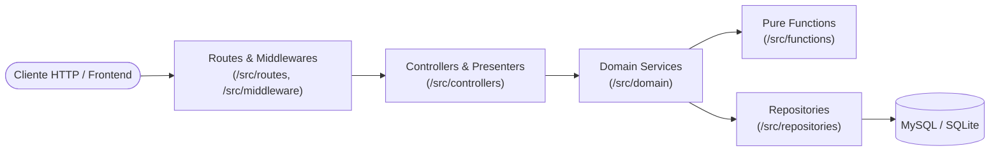

# Documentación Técnica — API REST (TrendFinder API)

Esta sección reúne las especificaciones técnicas exhaustivas de los endpoints REST, modelos de datos, arquitectura de capas y contratos de respuesta del backend de TrendFinder.

---

## 📌 Índice de Endpoints y Especificaciones

Para consultar el contrato detallado de cada endpoint (parámetros de consulta, payloads JSON de respuesta y casos de error), accede a su especificación correspondiente:

| Endpoint | Método | Descripción | Archivo de Especificación |
| :--- | :---: | :--- | :--- |
| `/api/sales` | `GET` | Tendencias analíticas de ventas con filtros de periodo (1, 7, 30 días) y paginación por cursores Base64. | [`sales_stats_endpoint.md`](sales_stats_endpoint.md) |
| `/api/products/stats/:id` | `GET` | Ficha analítica completa de producto, cálculo dinámico de DropScore, desglose financiero interactivo e historial de ventas. | [`product_stats_endpoint.md`](product_stats_endpoint.md) |
| `/api/products/search` | `GET` | Búsqueda de productos en el catálogo con filtros por país, ordenamiento y paginación tradicional. | [`product_search_endpoint.md`](product_search_endpoint.md) |
| `/api/products/latest` | `GET` | Últimos productos añadidos al catálogo con simulación inicial de márgenes. | [`latest_products_endpoint.md`](latest_products_endpoint.md) |

---

## 🏛️ Clean Architecture y Flujo de Dependencias

El backend está estructurado en capas concéntricas con estricta inversión de dependencias:

### Reglas de Capas
1. **Rutas y Middlewares (`api/src/routes/`, `api/src/middleware/`)**:
   - Enrutan las peticiones HTTP.
   - Aplican protección de rate limiting (`limiterMiddleware`) y cabeceras de seguridad (`helmet`).
   - Las rutas fijas (`/search`, `/latest`) deben registrarse **antes** de las rutas con comodines dinámicos (`/:id`).
2. **Controladores (`api/src/controllers/`)**:
   - Validan exhaustivamente las entradas (`req.query`, `req.params`, `req.body`).
   - Responden con `400 Bad Request` si los tipos o rangos son inválidos.
   - Aplican formateadores (*Presenters*) para convertir valores crudos en cadenas de moneda formateadas (`formatPrice`).
3. **Dominio (`api/src/domain/`)**:
   - Casos de uso de negocio puro.
   - Nunca manipulan `req` o `res`.
   - Invocan funciones matemáticas de cálculo (`DropScore`, márgenes COD/prepago) y consultan repositorios.
4. **Repositorios (`api/src/repositories/`)**:
   - Ejecutan consultas SQL puras con Sequelize.
   - No contienen lógica de presentación ni codificación HTTP.

---

## 🧪 Estrategia de Testing (Jest + SQLite en memoria)

Para asegurar la máxima velocidad y confiabilidad sin alterar las bases de datos de desarrollo:
- `NODE_ENV === 'test'` conecta automáticamente a SQLite en memoria (`sqlite3`, `:memory:`).
- Se utiliza `resetTestDb()` y `closeTestDb()` en `api/tests/helpers/setupTestDb.js`.
- Comando de ejecución: `npm test` dentro del directorio `api/`.

Para conocer cómo levantar el servidor en local y la receta paso a paso para añadir un nuevo endpoint, consulta la puerta de entrada en [`api/README.md`](../../api/README.md).
