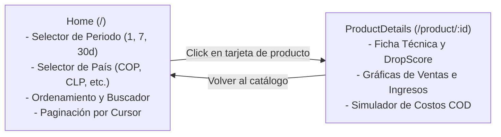

# Documentación Técnica — Frontend SPA (TrendFinder Web)

Esta sección reúne las guías técnicas sobre la arquitectura, catálogo de componentes, simulación financiera y testing automatizado de la aplicación web de TrendFinder.

---

## 📌 Guías Especializadas del Frontend

| Guía | Contenido Principal | Archivo |
| :--- | :--- | :--- |
| 🏛️ **Arquitectura y Servicios** | React 19 SPA, Vite 8, enrutamiento con React Router v7, cliente Axios centralizado (`trendFinder.js`) y ciclo de vida de componentes. | [`architecture.md`](architecture.md) |
| 🧩 **Catálogo de Componentes** | Guía de diseño de `SmartBadges` (DropScore), `FinancialInputsPanel` (calculadora interactiva COD vs prepago), gráficos y encapsulamiento con CSS Modules. | [`components.md`](components.md) |
| 🧪 **Estrategia de Testing** | Pruebas unitarias/integración con Vitest + MSW v3 y pruebas End-to-End herméticas con Playwright y Page Object Models. | [`testing.md`](testing.md) |

---

## 🔄 Flujo de Navegación y Vistas

Para la guía de inicio rápido en desarrollo local y comandos esenciales, consulta la puerta de entrada en [`web/README.md`](../../web/README.md).
