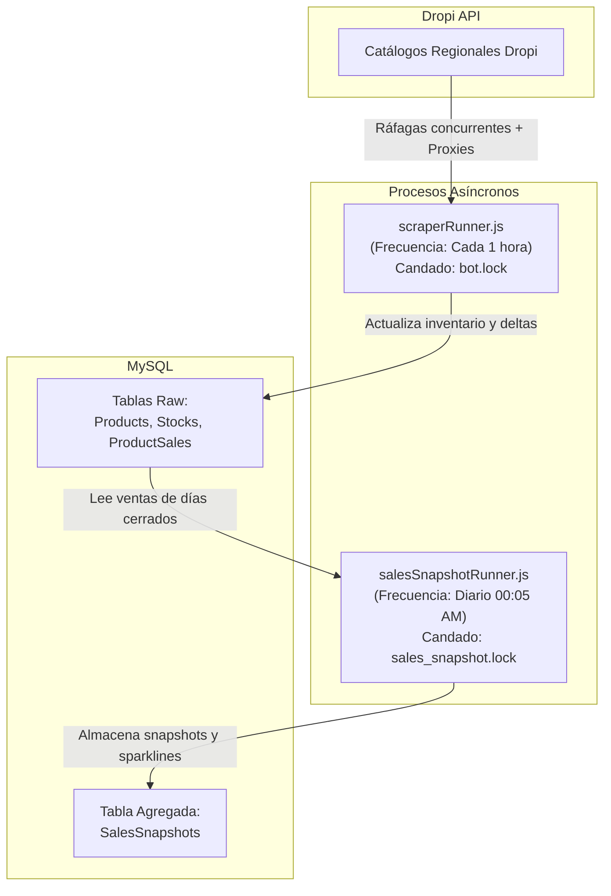

# Documentación Técnica — Bots & Workers (TrendFinder Workers)

Esta sección reúne las guías técnicas profundas sobre la arquitectura, automatización, resiliencia y monitoreo de los workers autónomos que ingieren y procesan el catálogo de Dropi.

---

## 📌 Guías Especializadas del Módulo

| Guía | Contenido Principal | Archivo |
| :--- | :--- | :--- |
| ⏰ **Crons y cPanel** | Configuración de crontab nativo en cPanel, CloudLinux `nodevenv`, ejecución desatendida y gestión de candados (`lockManager`). | [`cpanel-crons.md`](cpanel-crons.md) |
| 🛡️ **Resiliencia y Proxies** | Rotación de proxies en `proxies.txt`, túneles TCP `HttpsProxyAgent` (evasión de 405), Round-Robin de tokens Dropi (evasión de 429) y reintentos. | [`resilience-proxies.md`](resilience-proxies.md) |
| 📊 **Guardrails de Ingesta** | Algoritmos de discriminación de ventas reales: *Stock Zeroing*, retiros de lote de proveedor, horas offline y Winsorización de Tukey en sparklines. | [`inventory-guardrails.md`](inventory-guardrails.md) |
| 🚨 **Troubleshooting Operativo** | Matriz de incidentes frecuentes (429, candados bloqueados, proxies caídos, MySQL limits) y cheat sheet de comandos de emergencia por SSH. | [`troubleshooting.md`](troubleshooting.md) |

---

## 🔄 Resumen de los Workers Activos

Para la guía de inicio rápido y comandos esenciales, consulta la puerta de entrada en [`api/src/workers/README.md`](../../api/src/workers/README.md).
